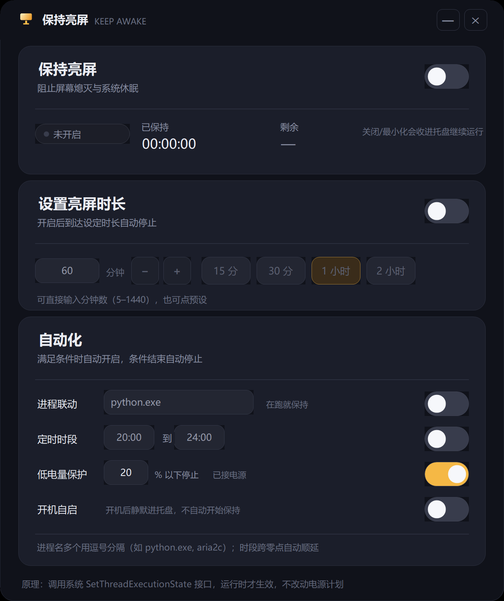

# 保持亮屏 · Keep Awake

一个 Windows 桌面小工具：**阻止屏幕熄灭与系统自动休眠**，想挂机跑训练、下载、看视频时不用再去改电源计划。

单文件 exe，无需安装、不依赖 .NET 之外的组件（Win7 sp1 及以上系统自带）。



## 功能

| 功能 | 说明 |
| --- | --- |
| 保持亮屏 | 调用 `SetThreadExecutionState` 申请 `DISPLAY_REQUIRED`，运行时才生效，退出即恢复，不改电源计划 |
| 限时自动停 | 5–1440 分钟，可直接键入数字，也可点 15 分 / 30 分 / 1 小时 / 2 小时预设 |
| 收进托盘 | 关闭、最小化、Esc、Alt+F4 都只收进托盘继续运行；托盘右键可显示窗口、开始/停止、看进度、退出 |
| 进程联动 | 指定进程（如 `python.exe`，支持逗号分隔多个）在跑就自动保持，进程结束自动停 |
| 定时时段 | 例如每天 20:00–24:00 自动保持，支持跨零点顺延 |
| 低电量保护 | 用电池且电量低于设定阈值（默认 20%）时自动停止，避免挂到没电 |
| 开机自启 | 写入 HKCU Run，带 `--minimized` 静默进托盘，不自动开始保持 |
| 单实例 | 二次启动不会开第二个窗口，而是唤出已有窗口 |

## 使用

双击 `保持亮屏.exe` 即可。设置存在 `%APPDATA%\KeepAwake\settings.ini`，删掉它就恢复默认。

- `--minimized`：启动后直接进托盘，不弹窗
- `--selftest`：跑一遍内置自检，把结果写到 `selftest.log`

## 从源码构建

只需要系统自带的 csc（.NET Framework 4.x 编辑器），不需要 Visual Studio 或 dotnet SDK：

```powershell
powershell -ExecutionPolicy Bypass -File .\build.ps1
```

脚本会调用 `C:\Windows\Microsoft.NET\Framework64\v4.0.30319\csc.exe`，把 `src` 下三个源文件编译成 `保持亮屏.exe`，同时把图标作为资源嵌入。

## 关于图标

`src\app.ico` 是 exe / 任务栏用的深色底图标（256/128/64/48/32/24/16 七档），`src\tray.ico` 是托盘用的透明底符号（48/32/24/20/16 五档），小尺寸单独简化过而不是简单缩放，这样 16px 下还能认出是「亮着的屏幕」。

图标由 `src\gen-icons.ps1` 用 System.Drawing 逐尺寸程序化绘制生成，不依赖外部素材：

```powershell
powershell -ExecutionPolicy Bypass -File .\src\gen-icons.ps1
```

## 实现要点

- `SetThreadExecutionState(ES_CONTINUOUS | ES_SYSTEM_REQUIRED | ES_DISPLAY_REQUIRED)`，每 30 秒续期一次
- 退出或关闭保持时置 `ES_CONTINUOUS`，把电源策略交还系统
- 界面用 WinForms 自绘（无边框深色卡片、自绘开关与胶囊按钮），按 `DpiX/96` 统一缩放，200% 缩放下不发虚
- 「自动」与「手动」冲突时用 `_manualBlock` 标记：限时到点后不会在定时时段内每 5 分钟循环重启
